# Modelo entidad-relación — Catálogo de sistemas y dependencias

Modelo derivado de [`oracle_catalogo_sistemas_dependencias.sql`](./oracle_catalogo_sistemas_dependencias.sql).
El diagrama utiliza notación Mermaid ER; los sufijos numéricos de tipo representan la longitud o precisión Oracle (por ejemplo, `VARCHAR2_200` = `VARCHAR2(200)` y `NUMBER19` = `NUMBER(19)`).

## Diagrama

```mermaid
erDiagram
    CATALOG_COMPONENT {
        NUMBER19 component_id PK
        VARCHAR2_30 component_type
        VARCHAR2_200 name
        VARCHAR2_50 acronym
        CLOB description
        CHAR1 is_active
        TIMESTAMP created_at
        TIMESTAMP updated_at
    }

    SYSTEM_DETAIL {
        NUMBER19 component_id PK, FK
        VARCHAR2_30 component_type FK
        CLOB business_objective
        VARCHAR2_200 owner_area
        VARCHAR2_20 criticality
        VARCHAR2_20 system_status
        DATE go_live_date
        DATE end_of_life_date
    }

    API_DETAIL {
        NUMBER19 component_id PK, FK
        VARCHAR2_30 component_type FK
        VARCHAR2_50 api_version
        VARCHAR2_2000 url
        VARCHAR2_30 protocol
        VARCHAR2_100 authentication_method
        CLOB sla_description
    }

    DATABASE_DETAIL {
        NUMBER19 component_id PK, FK
        VARCHAR2_30 component_type FK
        VARCHAR2_100 engine
        VARCHAR2_100 engine_version
        VARCHAR2_200 instance_name
        VARCHAR2_200 schema_name
    }

    INFRASTRUCTURE_DETAIL {
        NUMBER19 component_id PK, FK
        VARCHAR2_30 component_type FK
        VARCHAR2_255 hostname
        VARCHAR2_45 ip_address
        VARCHAR2_200 operating_system
        VARCHAR2_20 hosting_model
    }

    SYSTEM_DEPLOYMENT {
        NUMBER19 deployment_id PK
        NUMBER19 component_id FK
        VARCHAR2_20 environment
        VARCHAR2_2000 url
    }

    PERSON {
        NUMBER19 person_id PK
        VARCHAR2_200 full_name
        VARCHAR2_320 email UK
        VARCHAR2_200 organization
        CHAR1 is_active
    }

    RESPONSIBILITY_ROLE {
        NUMBER19 role_id PK
        VARCHAR2_40 role_code UK
        VARCHAR2_100 role_name UK
    }

    SYSTEM_RESPONSIBILITY {
        NUMBER19 component_id PK, FK
        NUMBER19 person_id PK, FK
        NUMBER19 role_id PK, FK
        CLOB notes
    }

    TECHNOLOGY {
        NUMBER19 technology_id PK
        VARCHAR2_30 category
        VARCHAR2_200 name
    }

    COMPONENT_TECHNOLOGY {
        NUMBER19 component_id PK, FK
        NUMBER19 technology_id PK, FK
        VARCHAR2_100 version
        CHAR1 is_primary
    }

    DEPENDENCY_TYPE {
        NUMBER19 dependency_type_id PK
        VARCHAR2_40 type_code UK
        VARCHAR2_100 type_name UK
    }

    DEPENDENCY {
        NUMBER19 dependency_id PK
        NUMBER19 origin_component_id FK
        NUMBER19 target_component_id FK
        NUMBER19 dependency_type_id FK
        VARCHAR2_10 dependency_scope
        VARCHAR2_20 criticality
        CLOB description
        TIMESTAMP created_at
    }

    DATA_FLOW {
        NUMBER19 data_flow_id PK
        NUMBER19 dependency_id FK
        VARCHAR2_200 data_name
        VARCHAR2_100 periodicity
        VARCHAR2_20 sensitivity
        VARCHAR2_100 data_format
        CLOB description
    }

    CATALOG_COMPONENT ||--o| SYSTEM_DETAIL : specializes_as_system
    CATALOG_COMPONENT ||--o| API_DETAIL : specializes_as_api
    CATALOG_COMPONENT ||--o| DATABASE_DETAIL : specializes_as_database
    CATALOG_COMPONENT ||--o| INFRASTRUCTURE_DETAIL : specializes_as_infrastructure

    SYSTEM_DETAIL ||--o{ SYSTEM_DEPLOYMENT : has_deployments
    SYSTEM_DETAIL ||--o{ SYSTEM_RESPONSIBILITY : assigns_responsibilities
    PERSON ||--o{ SYSTEM_RESPONSIBILITY : is_assigned
    RESPONSIBILITY_ROLE ||--o{ SYSTEM_RESPONSIBILITY : uses_role

    CATALOG_COMPONENT ||--o{ COMPONENT_TECHNOLOGY : uses_technology
    TECHNOLOGY ||--o{ COMPONENT_TECHNOLOGY : is_used_by

    CATALOG_COMPONENT ||--o{ DEPENDENCY : is_origin
    CATALOG_COMPONENT ||--o{ DEPENDENCY : is_target
    DEPENDENCY_TYPE ||--o{ DEPENDENCY : classifies
    DEPENDENCY ||--o{ DATA_FLOW : carries
```

## Cardinalidades y reglas

| Relación | Cardinalidad | Regla del esquema |
|---|---|---|
| `CATALOG_COMPONENT` → cada tabla `*_DETAIL` | Un componente tiene cero o un detalle de cada subtipo; cada detalle corresponde a exactamente un componente. | La PK del detalle es `component_id`; una FK compuesta `(component_id, component_type)` apunta a `CATALOG_COMPONENT`. Un `CHECK` fija el tipo de componente esperado. |
| `SYSTEM_DETAIL` → `SYSTEM_DEPLOYMENT` | Un sistema puede tener cero o muchos despliegues; cada despliegue pertenece a un sistema. | `UNIQUE (component_id, environment)` permite como máximo un despliegue por sistema y ambiente. |
| `SYSTEM_DETAIL`, `PERSON`, `RESPONSIBILITY_ROLE` → `SYSTEM_RESPONSIBILITY` | Cada asignación apunta a exactamente un sistema, persona y rol; cada uno puede aparecer en cero o muchas asignaciones. | PK compuesta `(component_id, person_id, role_id)`. |
| `CATALOG_COMPONENT`, `TECHNOLOGY` → `COMPONENT_TECHNOLOGY` | Muchos a muchos, resuelta por la tabla puente. | PK compuesta `(component_id, technology_id)`. |
| `CATALOG_COMPONENT` → `DEPENDENCY` como origen | Un componente puede ser origen de cero o muchas dependencias; cada dependencia tiene un origen. | FK `origin_component_id`. |
| `CATALOG_COMPONENT` → `DEPENDENCY` como destino | Un componente puede ser destino de cero o muchas dependencias; cada dependencia tiene un destino. | FK `target_component_id`; el origen y destino no pueden ser el mismo componente. |
| `DEPENDENCY_TYPE` → `DEPENDENCY` | Un tipo puede clasificar cero o muchas dependencias; cada dependencia usa un tipo. | FK `dependency_type_id`. |
| `DEPENDENCY` → `DATA_FLOW` | Una dependencia puede tener cero o muchos flujos; cada flujo corresponde a una dependencia. | FK `dependency_id` con borrado en cascada. |

### Convenciones y restricciones

- `PK`: clave primaria; `FK`: clave foránea; `UK`: restricción de unicidad.
- Los identificadores indicados como `NUMBER19` se generan con columnas `IDENTITY`, excepto las claves heredadas de `CATALOG_COMPONENT` en sus tablas de detalle.
- `CATALOG_COMPONENT` es el supertipo compartido. `SYSTEM_DETAIL`, `API_DETAIL`, `DATABASE_DETAIL` e `INFRASTRUCTURE_DETAIL` son subtipos; la FK compuesta asegura que el tipo coincida. El DDL no obliga a que todo componente tenga una fila de detalle.
- Las dependencias pueden conectar cualquier tipo de componente y son dirigidas: origen representa al consumidor y destino al proveedor.
- `COMPONENT_TECHNOLOGY` permite asociar tecnologías a cualquier componente, no solamente a sistemas.
- Los valores permitidos de estado, categoría, criticidad, ambiente, sensibilidad y otros campos están definidos mediante `CHECK` en el script Oracle.
- Las tablas puente y de detalle usan las reglas `ON DELETE CASCADE` declaradas en el DDL. Las otras relaciones conservan el comportamiento Oracle predeterminado al borrar una fila referenciada.
